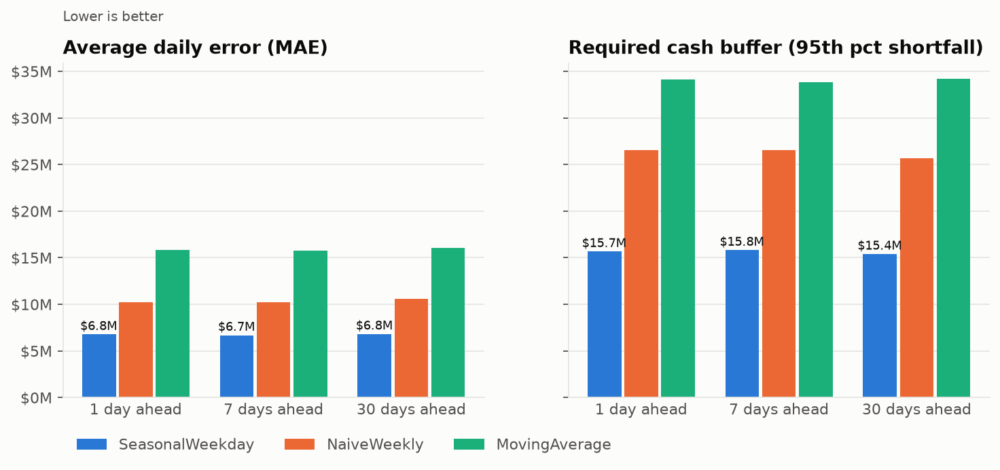
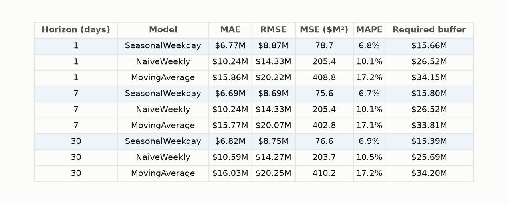
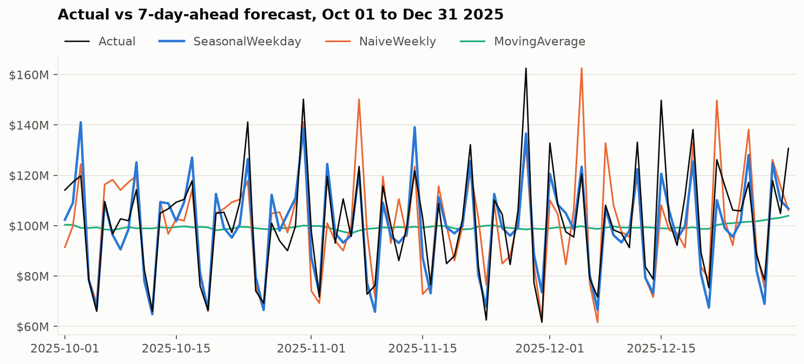
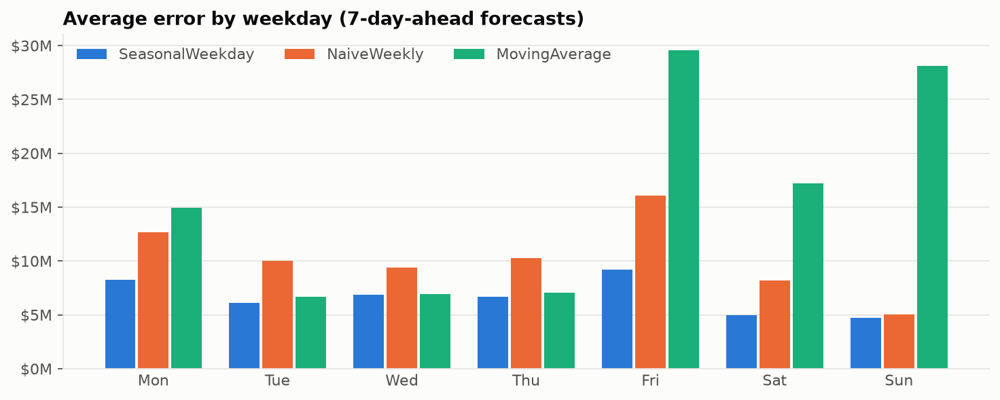

# Weekday-seasonal forecaster for daily money flows

A treasury team has to fund each day's outgoing payments before the day starts. If the
forecast is too low, they're short and need expensive same-day funding. If it's too high,
cash sits idle. This project forecasts daily payment volume 1 to 30 days ahead with a small
model you can explain in one sentence, **"recent level × day-of-week effect × payday effect"**,
and measures how much better it is than the naive rules of thumb teams often use.

## Headline result

On a year of out-of-sample, walk-forward forecasts, the seasonal model **cuts average daily
error by 35% against last-week's-value and by 58% against a 28-day moving average**. It also
**reduces the cash buffer needed to cover 95% of shortfalls from $26.5M to $15.8M a day**
(7-day horizon, on volumes averaging about $97M a day).



## Data

- **Synthetic (default):** daily outgoing payment volume in USD, 2021-01-01 to 2025-12-31,
  from [`data.py`](src/weekday_seasonal_forecaster/data.py). Every part is simulated and
  multiplied together, and each true part is saved in its own column so tests can check
  whether the model recovers it:
  - **Trend:** $50M a day at the start, growing 15% a year.
  - **Weekday:** Mon 1.10, Tue 1.00, Wed 0.95, Thu 1.00, Fri 1.25, Sat 0.80, Sun 0.70
    (rescaled to average 1).
  - **Paydays:** +25% on the 1st, +20% on the 15th and +30% on the last business day, with
    smaller lifts on the days around them.
  - **Annual:** a ±4% sine wave plus a December peak (+12% around the 20th).
  - **Noise:** about 6% log-normal noise.
- **Public (optional):** U.S. Treasury operating-cash withdrawals from the
  [Daily Treasury Statement](https://fiscaldata.treasury.gov/datasets/daily-treasury-statement/)
  (Fiscal Data API, business days only, public-debt redemptions excluded). See
  [data/README.md](data/README.md).

## Approach

- **Three models, one interface:** each model is a class with `fit(df)` and
  `predict(horizon or dates)` ([`models.py`](src/weekday_seasonal_forecaster/models.py)).
- **`NaiveWeekly` baseline:** the forecast for a day is the value on the same weekday last week.
- **`MovingAverage` baseline:** the forecast is the mean of the last 28 days.
- **`SeasonalWeekday` model (about 70 lines):**
  - **Weekday factors:** how much each weekday runs above or below a typical day, over the
    last 12 weeks. Each day is compared with the average of the 7 days around it, so growth
    and the December peak don't skew the factors.
  - **Payday factors:** the same idea for five day-of-month buckets (1–3, 4–13, 14–16,
    17 to month end, last 3 days), over the last year.
  - **Level:** the 28-day average after removing both effects.
  - **Forecast:** level × weekday factor × payday factor.
- **Untangling the two effects:** a payday that falls on a Friday would otherwise make
  Fridays look bigger. So the two sets of factors are estimated in turn for three passes.
- **No leakage:** at each forecast origin the model is refit using only data up to that day,
  and a test proves that changing later data doesn't change the forecasts.

## Evaluation

**Backtest:** a rolling-origin backtest over the last 365 days (calendar 2025). At every
origin each model is refit on history up to that day, then forecasts 1, 7 and 30 days
ahead. That gives 365 scored forecasts per model and horizon. Code:
[`evaluate.py`](src/weekday_seasonal_forecaster/evaluate.py).

**Required buffer, the dollar metric:** a shortfall is `max(actual − forecast, 0)`. The
required buffer is the 95th percentile of the daily shortfall: the extra cash you'd hold on
top of the forecast to cover the shortfall on 95% of days. Lower is better.



The full table is in [`reports/results.csv`](reports/results.csv).

### Why the simple seasonal model wins

- **The moving average ignores the weekly pattern.** It predicts about the same number every
  day (the flat green line below). It's always too low on Fridays and paydays and too high
  on weekends. Its weekend and Friday errors are 3–6× those of the seasonal model.
- **Last week's value carries last week's noise.** The naive forecast copies one noisy
  observation, so the forecast error includes both last week's random swing and this week's.
  It also misplaces paydays: last Tuesday was the 1st, but this Tuesday is the 8th.
- **The seasonal model averages the noise away.** It estimates each effect from many days,
  so only today's noise remains, and it knows which day of the month each payday falls on.
  Its error is close to the 6% noise built into the data. That smaller and steadier error
  is what shrinks the buffer.
- **Accuracy holds up to 30 days ahead.** The weekday and payday patterns are known in
  advance, and the level drifts slowly.





**Limits, stated honestly:**

- **December:** the model has no yearly component, so it under-forecasts the December peak
  (average error $11M from Dec 15 to 31, against $6.7M for the year).
- **Weekday window:** 12 weeks gives only 12 observations per weekday. Measured across many
  origins, the factors are typically within 2–3% of the truth but occasionally off by up to
  6%. A one-year window recovers them within 3%. It also lowers MAE slightly on this
  synthetic data, because the weekly pattern here never changes. The 12-week default is
  kept because real weekly patterns do drift.
- **Real Treasury data:** run with `--source treasury`. This data is much spikier: tax
  dates, benefit payment days and one-off transfers. The seasonal model still has the lowest
  MAE at every horizon, 26–36% below the baselines over the 12 months to November
  2026. At the 7-day horizon, though, `NaiveWeekly` needs a smaller buffer, because rare
  spikes dominate the 95th percentile. Handling those spikes is the goal of the next project.

## How to run

```bash
python3 -m venv .venv && source .venv/bin/activate
```

```bash
pip install -r requirements.txt
```

```bash
python scripts/run_pipeline.py && pytest
```

The pipeline takes a few seconds. It writes `reports/results.csv`,
`reports/error_by_weekday.csv`, every forecast in `reports/backtest_forecasts.csv.gz`, and
the charts in `reports/figures/`. Add `--source treasury` to run on public data instead
(needs internet; results go to `reports/treasury/`). Settings such as windows, horizons and
the seed are in [`config.py`](src/weekday_seasonal_forecaster/config.py). For a guided tour,
see [`notebooks/walkthrough.ipynb`](notebooks/walkthrough.ipynb).

### Tests

- **Weekday factors** average to 1.0.
- **Recovery:** on synthetic data, the recovered weekday factors are within ±5% of the true
  ones with a one-year window, and within 2.5% on average with the 12-week default.
- **No leakage:** forecasts made at any origin are unchanged when every value after that
  origin is altered. This is checked for all three models.
- **Metrics:** MAE, MSE, RMSE, MAPE and required buffer are checked against hand-computed
  values.
- **Headline claim:** the seasonal model beats both baselines on MAE and on required buffer.

## What I'd do next

- **Yearly effect:** add a smoothed day-of-year factor estimated from prior years, to
  capture the December peak.
- **Spikes and holidays:** separate rare large-flow days and holiday effects from the
  normal pattern (the next project, `treasury-cashflow-forecaster`).
- **Uncertainty bands:** give intervals from empirical residual quantiles, so the buffer
  comes from the model instead of the backtest.
- **Adaptive windows:** choose the weekday and level windows by backtest instead of fixing
  them.
- **Overstock cost:** add the cost of over-forecasting (idle cash × cost of capital) next to
  the shortfall buffer.
